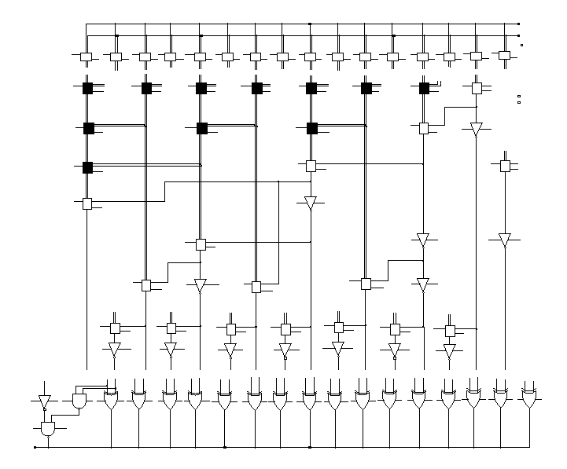
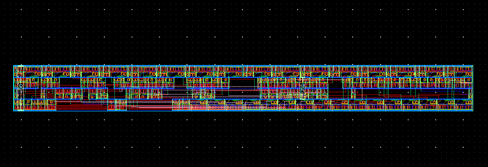

# Brent-Kung-Tree-Adder
Physical Layout design of Brent–Kung Tree Adder : To design and analyze a Brent–Kung Tree adder architecture. 

The study focuses on evaluating its critical path delay, area, and power characteristics to assess overall performance and efficiency.

## Brent–Kung Tree Adder Architecture

## Layout of Brent–Kung Tree Adder

### Report
[DVLSI_assignment_06_27002.pdf](./DVLSI_assignment_06_27002.pdf)
